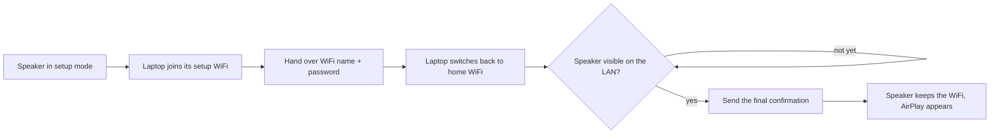

# airplay-wifi-setup

Put an AirPlay speaker onto your WiFi from a Linux machine when the vendor app and the iPhone
setup sheet refuse to cooperate. It speaks Apple's accessory setup protocol (WAC) directly and,
unlike the apps on the speaker we tested, finishes the handshake so the speaker actually keeps
the credentials.

> **Credit where it is due.** The protocol implementation is
> [BertoldVdb/WACResearch](https://github.com/BertoldVdb/WACResearch) by Bertold Van den Bergh,
> who reverse-engineered Wireless Accessory Configuration and published it under the MIT license.
> This project adds a small patch and the orchestration around it. If this helped you, star that
> repo too.

## How it works



Under the hood these are four HTTP requests to a tiny server on the speaker:

| Step | Request | Where |
|---|---|---|
| 1 | `POST /auth-setup` – key exchange, the speaker proves itself with its MFi chip | speaker's setup AP |
| 2 | `POST /config` – SSID, password and new device name, encrypted | speaker's setup AP |
| 3 | speaker joins your WiFi and re-announces `_mfi-config._tcp` via mDNS | your LAN |
| 4 | `POST /configured` – "I can see you, you're done" | your LAN |

Step 4 is the one that gets lost. Without it the speaker keeps the WiFi only until the next
power-cycle, then falls back into setup mode. That is exactly the symptom the apps showed.

## Tested devices

| Device | Firmware | Result | Notes |
|---|---|---|---|
| Edifier D32 | p20.55.0 (AirPlay SDK) | works, 33 s end to end | setup server accepts one TCP connection; `/configured` on port 5001 |

Got it working (or not) on something else? Open an issue or PR with the device, firmware and
the log, and it goes into this table. Any accessory advertising `_mfi-config._tcp` on its setup
AP is a candidate.

## Quick start

Requirements: Linux, Go 1.22+, `git`, mDNS allowed on your LAN. NetworkManager for the automatic
WiFi switching; without it you switch by hand when prompted. One WiFi interface is enough.

```bash
./build.sh                                           # fetches + patches WACResearch, builds bin/airplay-wifi-setup
cp airplay-wifi-setup.conf.example airplay-wifi-setup.conf
$EDITOR airplay-wifi-setup.conf                      # SSID, password, speaker name, how to switch WiFi
# put the speaker into WiFi setup mode (blinking LED, open "VENDOR xxxx" network)
./bin/airplay-wifi-setup
```

A successful run takes about half a minute. This is a real one, lightly anonymised:

```
20:49:33 target network "MyWifi" (password: 11 chars), accessory name "Edifier D32"
20:49:33 running hook: hooks/networkmanager/join-ap.sh
joining setup AP 6C:16:29:xx:xx:xx on wlan0
20:49:48 found WAC service "Edifier D32" at 192.168.0.1:5000 (device id 6C:16:29:xx:xx:xx, seed 1)
20:49:49 credentials delivered
20:49:49 running hook: hooks/networkmanager/join-home.sh
joining 'MyWifi'
20:49:52 looking for the accessory on "MyWifi" (up to 300s)...
20:50:03 mDNS: accessory at 192.168.0.100, WAC port 5001, seed 2
20:50:03 /configured accepted on 192.168.0.100:5001. The accessory now keeps the credentials.
20:50:03 waiting for the accessory's services to start...
20:50:06 _airplay._tcp announced by "Edifier D32" at 192.168.0.100:7001
```

## Configuration

`airplay-wifi-setup.conf` is a plain `KEY=VALUE` file; every key also works as an environment
variable `WAC_<KEY>`. The example file documents all keys. The ones you will touch:

| Key | Meaning |
|---|---|
| `SSID`, `PASSWORD` | the WiFi the speaker should join |
| `PASSWORD_CMD` | instead of `PASSWORD`: a command that prints it (`pass`, `secret-tool`, …) |
| `NM_CONNECTION` | instead of both: read SSID and PSK from a saved NetworkManager connection |
| `DEVICE_NAME` | name the speaker announces afterwards |
| `AP_PATTERN` | regex matching the setup AP's SSID, e.g. `edifier\|d32` |
| `HOOK_JOIN_AP`, `HOOK_JOIN_HOME` | commands that switch your WiFi; leave empty to do it by hand when prompted |
| `CONFIRM_PORTS`, `WAIT_SECONDS` | where and how long to try the final `/configured` |
| `INSECURE` | skip MFi certificate validation if your speaker's chain is unknown |

Flags: `-c <file>`, `-ssid`, `-name`, `-device host:port`, `-insecure`, `-already-on-ap`, and
`-check` to print the resolved configuration (password only as a length). The password is
deliberately not a flag, so it never appears in `ps` or shell history.

**Hooks** are shell commands that receive `WAC_SSID`, `WAC_AP_PATTERN`, `WAC_IFACE` and
`WAC_NM_CONNECTION`. NetworkManager hooks ship in `hooks/networkmanager/`; ones for `iwd` or
`wpa_cli` are a few lines, PRs welcome. With no hooks the program stops twice and waits for Enter.

## Things we learned the hard way

Seen on the Edifier D32, probably true for other accessories built on the same AirPlay SDK.

- **The setup-mode server accepts exactly one TCP connection.** Any probe (`curl`, a port scan)
  makes it refuse everything until the speaker is power-cycled. The stock WACResearch client
  opens a connection per request and fails on the second; `patches/` fixes that, and the program
  never probes before the real request.
- **`/configured` moves to another port** on the LAN (5000 became 5001). mDNS tells us when it
  works; otherwise `CONFIRM_PORTS` are tried in order.
- **The confirmation window is short**, about a minute. The search starts the moment the WiFi
  switch finishes.
- **mDNS from the speaker can be unreliable.** Fallback: poke every host on the /24 so the
  kernel resolves ARP, then find the speaker by MAC. No root needed.
- **Setup SSIDs may contain non-printable bytes**, so the hook connects by BSSID, not by name.

## Troubleshooting

| Symptom | Cause / fix |
|---|---|
| `connection refused` on `/auth-setup` | setup server already used up: power-cycle, re-enter setup mode, run again |
| certificate / signature error | unknown MFi chain: set `INSECURE=true` |
| "gave up" after the WiFi switch | confirmation never arrived; speaker will forget the WiFi on reboot. Check router client isolation (guest networks!) and retry |
| speaker pingable but no AirPlay | step 4 missing: wait 30 s or re-run |
| hook finds no setup AP | adjust `AP_PATTERN`, or leave the hook empty and join by hand |

## Notes

**Security.** A WAC accessory does not authenticate the configurator (a WACResearch finding).
This tool uses the same protocol the vendor app uses, for devices you own and are standing next
to; credentials travel encrypted exactly as a phone would send them.

**About this project.** Built in one evening to get a stubborn speaker online, then cleaned up so
it might help someone else. Code and most of the text were written with the help of an AI
assistant (Claude); a human ran it against a real speaker, read the results and decided what to
keep. Read the scripts before you run them, and open an issue if your accessory behaves
differently.

**Trademarks.** AirPlay is a trademark of Apple Inc. This project is not affiliated with or
endorsed by Apple or Edifier.

**License.** MIT, see `LICENSE`. WACResearch is fetched at build time at a pinned commit and
patched; it keeps its own MIT license.
